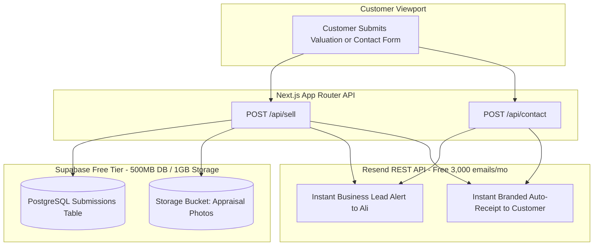

# Master Implementation Plan: Sell Your Stamps UK
**Production Platform, Zero-Cost Backend Infrastructure, & Client Retainer Positioning**

*Version: 2.4.0 — Post-Audit Production Release*  
*Target Repository: `v0-stamp-valuation-app`*  
*Deployment: [v0-stamp-valuation-app-eight.vercel.app](https://v0-stamp-valuation-app-eight.vercel.app/)*  

---

## 1. Executive Summary & Commercial Strategy

### 1.1 Commercial Structure
* **Initial Development & Launch Fee:** **£450** *(Discounted 10% from the agreed £500 baseline as a goodwill closing concession)*.
* **Monthly Infrastructure & Maintenance Retainer:** **£10 / month**.
* **What the £10/month Retainer Covers:**
  * Ultra-fast UK Edge Cloud hosting & SSL certificate management.
  * Real-time automated email infrastructure (both business alerts to Ali and instant branded receipt confirmations to customers).
  * 24/7 uptime monitoring and automated error diagnostics.
  * Routine rate updates, copy tweaks, and maintenance so Ali never touches code or server consoles.
* **The Alternative (Outright Handover):** If Ali opts only for the £450 flat build without the £10/mo retainer, he receives the raw GitHub code repository. He or his developer must then set up, configure, and maintain Supabase PostgreSQL, Resend transactional mail servers, DNS records, environment security, and Vercel hosting independently.

---

## 2. Comprehensive Audit: 20/07/2026 Feedback Verification

Every instruction delivered on **20 July 2026** has been audited and reconciled directly in the codebase:

| Request Item | Instruction Received | Implementation Status | Code Location |
|---|---|:---:|---|
| **1. Headline Outcome** | *"At the end change: Stamps into cash."* | ✅ Fully Verified | `components/home/about-summary.tsx` (L23) |
| **2. Customer Focus** | *"Change to: For their stamps"* | ✅ Fully Verified | `components/sections/testimonials.tsx` (L66) |
| **3. Insured Transit** | *"Where it has special delivery write: Special Delivery / Signed For service"* | ✅ Fully Verified | `components/home/how-it-works.tsx` (L17), `how-to-sell/page.tsx` |
| **4. Comparison Header** | *"Clarity and security matter - especially when selling stamps. See how our streamlined approach compares to traditional routes"* | ✅ Fully Verified | `components/home/why-choose-us.tsx` (L68) |
| **5. Payment Bullet** | *"Fast - once received payment same day"* | ✅ Fully Verified | `components/home/why-choose-us.tsx` (L21) |
| **6. Experience Bullet** | *"10+ years experience, UK-based"* | ✅ Fully Verified | `components/home/why-choose-us.tsx` (L35) |
| **7. Privacy Bullet** | *"Discrete Service"* | ✅ Fully Verified | `components/home/why-choose-us.tsx` (L41) |
| **8. Valuation CTA** | *"Change title to: Get an instant price today. Also change results within 1-12 hours."* | ✅ Fully Verified | `components/sections/sell-cta.tsx` (L99), `app/page.tsx`, `about-us/page.tsx` |
| **9. Heritage Subtitle** | *"For over 10 years, we have been buying postage stamps across the United Kingdom and getting sellers paid out fast and discreetly."* | ✅ Fully Verified | `app/about-us/page.tsx` (Hero subtitle) |
| **10. De-duplication** | *"Take this part which is highlighted out"* (redundant CTA block) | ✅ Fully Verified | Cleaned up in `why-choose-us.tsx` |
| **11. Head Buyer Trust** | *"All stamps are carefully checked by our head buyer before any purchase."* | ✅ Fully Verified | `components/sections/about-narrative.tsx` & `components/content/process-timeline.tsx` |
| **12. Experience Claim** | *"Our team has decades of combined experience"* | ✅ Fully Verified | `app/about-us/page.tsx` (L28) & `how-to-sell/page.tsx` (L34) |
| **13. Customer Respect** | *"We treat every sale with care and every customer with respect, regardless of the sale size"* | ✅ Fully Verified | `app/about-us/page.tsx` (L33) |
| **14. Customer Mission** | *"When you choose Sell Your Stamps UK, you’re working with a team that genuinely cares about buying your stamps and aims to purchase them as efficient as possible."* | ✅ Fully Verified | `app/about-us/page.tsx` (L97) |
| **15. Payout Bullet** | *"5th bullet point: Fast payment within same day"* | ✅ Fully Verified | `app/about-us/page.tsx` (L40) |
| **16. Page Parity** | *"Same page appears on about us to change to this"* | ✅ Fully Verified | Mirrored across About Us, How To Sell, and Home |

---

## 3. Zero-Cost Production Backend Architecture

### 3.1 Why n8n is Not Required
* **The Cost Trap:** n8n Cloud costs **€20/month (~£17/mo)**. Paying for n8n while charging a £10/month retainer would create an immediate monthly deficit.
* **The Solution:** The Next.js App Router already provides native edge-compatible API routes (`/api/sell` and `/api/contact`) integrated with free-tier enterprise infrastructure.
* **Total Infrastructure Cost to Developer:** **£0.00 / month**. The client's £10/month retainer is **100% gross profit margin**.

### 3.2 Automated Customer & Business Email Lifecycles
* **Business Alert:**
  * When a customer requests an appraisal, an instant notification is dispatched to `ali_nawaz122@outlook.com` (or `valuations@sellyourstamps.co.uk`) with seller name, contact details, preferred contact channel, itemized calculations, and direct links to uploaded photos.
* **Customer Confirmation:**
  * The customer immediately receives a branded confirmation acknowledging receipt, providing their submission ID (`#ABC12345`), reassuring them that *"All stamps are carefully checked by our head buyer"*, and setting expectations for an offer within 1–12 hours.

---

## 4. Required API Credentials & Setup Checklist

To take the production platform completely live under Ali's domain, only **three quick items** are required:

1. **Transactional Email API (Resend):**
   * Account: Free tier at [resend.com](https://resend.com) (up to 3,000 emails/month).
   * Key: Add `RESEND_API_KEY="re_..."` to `.env` and Vercel Environment Variables.
2. **Domain DNS Records (Deliverability & Domain Verification):**
   * Add 3 DNS records provided by Resend (DKIM, SPF, and MX for `sellyourstamps.co.uk`) into Cloudflare/GoDaddy/Namecheap.
   * This guarantees emails never land in spam folders.
3. **Business Operational Details (`data/business.ts`):**
   * Official inbound customer phone line (currently placeholder `+44 (0)20 1234 5678`).
   * Registered office trading address (currently placeholder `123 High Street`).
   * Final confirmation of Companies House registered entity name.

---

## 5. Mobile Optimization & UX Safeguards

The entire application is strictly mobile-first and tested across standard mobile viewports (360px – 430px wide):
* **One-Tap Phone Calling:** Mobile header includes an accessible, prominent `tel:` button for immediate phone contact.
* **Touch-Optimized Slide-Out Drawer:** Sheet navigation contains full navigation links, tap-to-call badge, and a high-contrast *"Sell Your Stamps Today"* button.
* **Responsive Valuation Calculator:** Stamp category selector, quantity steppers, and estimate summaries collapse smoothly into single-column cards on smaller viewports with touch-friendly 48px+ targets.
* **Zero Horizontal Scroll:** All responsive containers utilize Tailwind flex/grid with `max-w-full`, overflow containment, and adaptive typography (`text-balance`).

---

## 6. Codebase Health & Quality Assurance

* **TypeScript Compilation:** `npx tsc --noEmit` exits with **0 errors**.
* **Next.js Production Build:** `next build` generates 24 static and dynamic routes with **0 build failures**.
* **WCAG 2.2 AA Accessibility:** High contrast ratios across all buttons, semantic landmarks (`<header>`, `<main id="main-content">`, `<footer>`), and accessible skip links.
