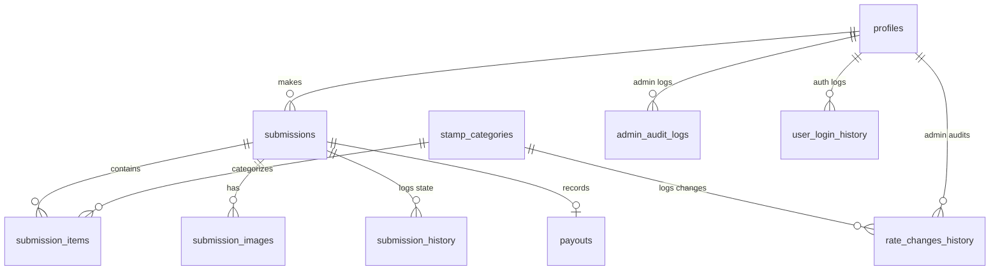
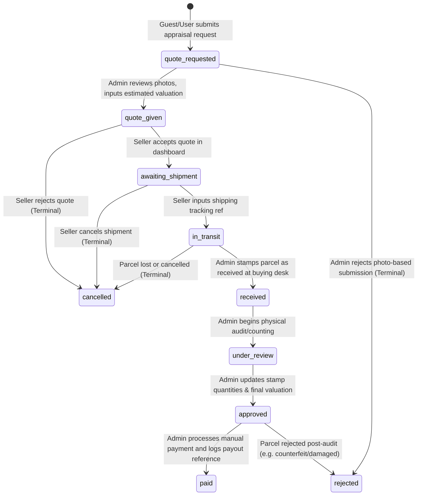

# Implementation Plan - Backend & Dashboards

This document outlines the detailed, step-by-step implementation plan for integrating a Supabase backend, database, storage buckets, and user authentication with the **Sell Your Stamps UK** webapp. It includes design systems, data models, admin management tools, and a secure client portal for tracking valuations and payments.

---

## 1. 🎨 Branding & Visual Identity Guide

To ensure all new dashboard interfaces feel premium, cohesive, and aligned with the public-facing site:
*   **Color Palette (defined in `app/globals.css`):**
    *   `Midnight Navy` (`#0B1D2E`): Primary sidebar, header text, and dark backgrounds.
    *   `Heritage Green` (`#14452F`): Primary CTA buttons, status badges for "Approved" or "Paid", and key action buttons.
    *   `Warm Gold` (`#C5A059`): Accents, borders, rating stars, and status badges for "Quote Ready" or "Under Review".
    *   `Soft Smoke Grey` (`#E8EBE9`): Subtle background fills, borders, and input fields.
    *   `Parchment Off-White` (`#FBFBF9`): Dashboard page background to evoke trust and high-end editorial quality.
*   **Typography:**
    *   **Headings & Accents:** `Playfair Display` (serif) - conveys heritage, expertise, and institutional trust.
    *   **UI Controls & Body Text:** `Inter` (sans-serif) - clean, modern, and highly readable.
*   **Toasts:** Top-left toast notifications (via `sonner`) with custom branding borders matching status changes.

---

## 2. 🧠 Database Schema (Supabase PostgreSQL)

We will provision the following tables, triggers, and indices in PostgreSQL.



### Table 1: `profiles` (Linked to Supabase Auth)
Stores user roles, account state, and secure payout details.
```sql
CREATE TYPE user_role AS ENUM ('user', 'seller', 'admin');
CREATE TYPE account_status AS ENUM ('active', 'restricted', 'banned');

CREATE TABLE public.profiles (
    id UUID PRIMARY KEY REFERENCES auth.users(id) ON DELETE CASCADE,
    email TEXT UNIQUE NOT NULL,
    full_name TEXT,
    phone TEXT,
    postcode TEXT,
    role user_role DEFAULT 'user'::user_role NOT NULL,
    status account_status DEFAULT 'active'::account_status NOT NULL,
    ban_reason TEXT,
    payout_details JSONB DEFAULT '{}'::jsonb, -- Securely stores encrypted/hashed bank info (Sort Code, Account Number)
    created_at TIMESTAMP WITH TIME ZONE DEFAULT CURRENT_TIMESTAMP NOT NULL,
    updated_at TIMESTAMP WITH TIME ZONE DEFAULT CURRENT_TIMESTAMP NOT NULL
);
```

### Table 2: `stamp_categories` (Stamp Rates Catalog)
Holds the active buying rates and availability states.
```sql
CREATE TABLE public.stamp_categories (
    id TEXT PRIMARY KEY, -- e.g., '1st-purple-complete-sheets-25-50'
    name TEXT NOT NULL,
    group_name TEXT NOT NULL, -- '1st Class', '2nd Class', 'Barcoded Values', etc.
    description TEXT,
    face_value NUMERIC(10, 2) NOT NULL,
    rate NUMERIC(4, 3) NOT NULL, -- e.g., 0.570 for 57%
    image_url TEXT,
    is_barcoded BOOLEAN DEFAULT TRUE NOT NULL,
    allow_decimal BOOLEAN DEFAULT FALSE NOT NULL,
    min_quantity NUMERIC(12, 2),
    max_quantity NUMERIC(12, 2),
    condition_requirements TEXT,
    is_active BOOLEAN DEFAULT TRUE NOT NULL,
    paused_reason TEXT,
    paused_at TIMESTAMP WITH TIME ZONE,
    created_at TIMESTAMP WITH TIME ZONE DEFAULT CURRENT_TIMESTAMP NOT NULL,
    updated_at TIMESTAMP WITH TIME ZONE DEFAULT CURRENT_TIMESTAMP NOT NULL
);
```

### Table 3: `submissions` (Valuation Requests)
Tracks quotes, statuses, shipping numbers, and links to user profiles.
```sql
CREATE TYPE submission_status AS ENUM (
    'quote_requested', 'quote_given', 'awaiting_shipment', 
    'in_transit', 'received', 'under_review', 
    'approved', 'paid', 'rejected', 'cancelled'
);

CREATE TABLE public.submissions (
    id UUID PRIMARY KEY DEFAULT gen_random_uuid(),
    user_id UUID REFERENCES public.profiles(id) ON DELETE SET NULL, -- Nullable for Guest submissions
    guest_name TEXT,
    guest_email TEXT,
    guest_phone TEXT,
    guest_postcode TEXT,
    collection_type TEXT NOT NULL,
    approx_quantity TEXT NOT NULL,
    estimated_era TEXT NOT NULL,
    description TEXT NOT NULL,
    valuable_items TEXT,
    estimated_valuation NUMERIC(12, 2) NOT NULL,
    final_reviewed_valuation NUMERIC(12, 2),
    status submission_status DEFAULT 'quote_requested'::submission_status NOT NULL,
    tracking_reference TEXT,
    date_received TIMESTAMP WITH TIME ZONE,
    rejection_reason TEXT,
    rejection_at TIMESTAMP WITH TIME ZONE,
    cancellation_reason TEXT,
    cancellation_at TIMESTAMP WITH TIME ZONE,
    created_at TIMESTAMP WITH TIME ZONE DEFAULT CURRENT_TIMESTAMP NOT NULL,
    updated_at TIMESTAMP WITH TIME ZONE DEFAULT CURRENT_TIMESTAMP NOT NULL
);
```

### Table 4: `submission_items` (Calculation Breakdown Snapshot)
Saves the specific category breakdown. Copies the rate to prevent retroactive changes if catalog updates.
```sql
CREATE TABLE public.submission_items (
    id UUID PRIMARY KEY DEFAULT gen_random_uuid(),
    submission_id UUID REFERENCES public.submissions(id) ON DELETE CASCADE NOT NULL,
    category_id TEXT REFERENCES public.stamp_categories(id) ON DELETE SET NULL,
    quantity NUMERIC(12, 2) NOT NULL,
    rate_at_submission NUMERIC(4, 3) NOT NULL,
    face_value_at_submission NUMERIC(10, 2) NOT NULL,
    calculated_value NUMERIC(12, 2) NOT NULL,
    reviewed_quantity NUMERIC(12, 2), -- Populated by admin on physical audit
    reviewed_value NUMERIC(12, 2)     -- Populated by admin on physical audit
);
```

### Table 5: `submission_images` (File Upload Details)
```sql
CREATE TABLE public.submission_images (
    id UUID PRIMARY KEY DEFAULT gen_random_uuid(),
    submission_id UUID REFERENCES public.submissions(id) ON DELETE CASCADE NOT NULL,
    image_url TEXT NOT NULL,
    file_path TEXT NOT NULL, -- Storage path in Supabase bucket
    created_at TIMESTAMP WITH TIME ZONE DEFAULT CURRENT_TIMESTAMP NOT NULL
);
```

### Table 6: `payouts` (Manual Payment Logs)
```sql
CREATE TYPE payout_method_type AS ENUM ('bank_transfer', 'cheque');

CREATE TABLE public.payouts (
    id UUID PRIMARY KEY DEFAULT gen_random_uuid(),
    submission_id UUID UNIQUE REFERENCES public.submissions(id) ON DELETE CASCADE NOT NULL,
    method payout_method_type NOT NULL,
    amount NUMERIC(12, 2) NOT NULL,
    reference_number TEXT NOT NULL, -- Bank reference or cheque number
    issued_by UUID REFERENCES public.profiles(id) NOT NULL, -- Admin user ID
    recipient_name TEXT NOT NULL,
    recipient_details JSONB DEFAULT '{}'::jsonb NOT NULL, -- Masked account/sort codes or cheque address
    paid_at TIMESTAMP WITH TIME ZONE DEFAULT CURRENT_TIMESTAMP NOT NULL
);
```

### Audit Log Tables (History Logs)
```sql
-- Category rate modification logging
CREATE TABLE public.rate_changes_history (
    id UUID PRIMARY KEY DEFAULT gen_random_uuid(),
    category_id TEXT REFERENCES public.stamp_categories(id) ON DELETE CASCADE NOT NULL,
    changed_by UUID REFERENCES public.profiles(id) NOT NULL,
    old_rate NUMERIC(4, 3) NOT NULL,
    new_rate NUMERIC(4, 3) NOT NULL,
    changed_at TIMESTAMP WITH TIME ZONE DEFAULT CURRENT_TIMESTAMP NOT NULL
);

-- Submission status lifecycle changes
CREATE TABLE public.submission_history (
    id UUID PRIMARY KEY DEFAULT gen_random_uuid(),
    submission_id UUID REFERENCES public.submissions(id) ON DELETE CASCADE NOT NULL,
    changed_by UUID REFERENCES public.profiles(id),
    old_status submission_status NOT NULL,
    new_status submission_status NOT NULL,
    notes TEXT,
    created_at TIMESTAMP WITH TIME ZONE DEFAULT CURRENT_TIMESTAMP NOT NULL
);

-- Admin critical operations
CREATE TABLE public.admin_audit_logs (
    id UUID PRIMARY KEY DEFAULT gen_random_uuid(),
    admin_id UUID REFERENCES public.profiles(id) NOT NULL,
    action_type TEXT NOT NULL, -- 'ROLE_CHANGE', 'USER_BAN', 'MANUAL_OVERRIDE'
    target_user_id UUID REFERENCES public.profiles(id),
    details JSONB DEFAULT '{}'::jsonb,
    reason TEXT,
    created_at TIMESTAMP WITH TIME ZONE DEFAULT CURRENT_TIMESTAMP NOT NULL
);

-- Session tracking
CREATE TABLE public.user_login_history (
    id UUID PRIMARY KEY DEFAULT gen_random_uuid(),
    user_id UUID REFERENCES public.profiles(id) ON DELETE CASCADE NOT NULL,
    ip_address TEXT,
    user_agent TEXT,
    logged_at TIMESTAMP WITH TIME ZONE DEFAULT CURRENT_TIMESTAMP NOT NULL
);
```

---

## 3. 🚦 Submission State & Role Lifecycle



### Role Trigger Upgrades:
*   Upon signup, a user defaults to `role = 'user'`.
*   An automatic database trigger runs when a submission is created: if the associated profile has `role = 'user'`, it updates to `'seller'`.
*   **Banned Users:** A trigger blocks Supabase logins if a profile's `status` is set to `'banned'`.

---

## 4. 📂 Directory & Page Routing Structure

We will implement the following routes using Next.js App Router.

```
app/
├── (auth)/
│   ├── login/page.tsx               # Login page with Email + Magic Link options
│   ├── signup/page.tsx              # Sign up page
│   └── logout/route.ts              # Route handler to destroy cookies
├── dashboard/                       # Secure client-facing space
│   ├── layout.tsx                   # Seller dashboard navigation layout
│   ├── page.tsx                     # List of seller submissions & stats
│   ├── submissions/
│   │   └── [id]/page.tsx            # Submission details, tracking updates, quote acceptance
│   └── settings/page.tsx            # Bank details configuration and account settings
├── admin/                           # Secure admin space
│   ├── layout.tsx                   # Admin sidebar layout
│   ├── page.tsx                     # Admin overview (submission counts, charts)
│   ├── submissions/
│   │   ├── page.tsx                 # Submissions list with search, pagination, and status filters
│   │   └── [id]/page.tsx            # Appraisal editor (verify quantities, process payouts, upload images)
│   ├── categories/
│   │   └── page.tsx                 # Stamp rates manager (CRUD, pausing)
│   ├── sellers/
│   │   └── page.tsx                 # Seller management list (bans, activity audit)
│   └── reports/
│       └── page.tsx                 # Valuation graphs, payouts metrics, and category volumes
```

---

## 5. 🛠️ Step-by-Step Implementation Steps

### Phase 1: Supabase Setup & RLS Configuration
1. **Define Schema:** Run the database migrations to provision tables, triggers, and types.
2. **Setup DB Trigger for Profiles:** Create a Postgres function and trigger to automatically insert a record into `public.profiles` when a user registers via `auth.users`.
3. **Configure Storage Bucket:** Create a private bucket called `submissions` with policies:
   *   `INSERT`: Allowed for authenticated users if upload matches `{auth.uid()}/...`.
   *   `SELECT`: Allowed if `auth.uid() = user_id` of submission OR if user's role is `'admin'`.
4. **Implement Row Level Security (RLS) Policies:**
   *   `profiles`: Read/write allowed for owner; Admins have full access.
   *   `submissions`: Read/Write for owner; Read/Write for Admins. Guests can `INSERT`.
   *   `stamp_categories`: Read for everyone; Write restricted to Admins.

### Phase 2: Authentication Flows
1. **Magic Link Integration:** Implement login via Supabase client using OTP/Magic Link:
   *   `supabase.auth.signInWithOtp({ email, options: { emailRedirectTo: '/dashboard' } })`.
2. **Role Checker Middleware:** Create Next.js server-side checks in `middleware.ts` to redirect users attempting to access `/admin` or `/dashboard` without correct permissions.

### Phase 3: Guest Valuation Linkage
1. **Modify `/api/sell/route.ts`:**
   *   On submission, check if user is logged in. If yes, save with `user_id`.
   *   If guest, save with `guest_email`, `guest_phone`, etc.
   *   Upon user profile creation in the database, execute a Postgres trigger checking for any existing submissions where `guest_email = new_profile.email` and automatically link them.

### Phase 4: Client Dashboard Layout
1. **Build `/dashboard/page.tsx`:** List active submissions with colored status indicators (Midnight Navy for requests, Heritage Green for payouts).
2. **Build `/dashboard/submissions/[id]/page.tsx`:**
   *   Display timeline steps.
   *   "Accept Quote" CTA: Updates status to `awaiting_shipment` and expands the shipping instructions card.
   *   "Shipment Tracking": Form to enter carrier name and tracking number, updating status to `in_transit`.
3. **Build Payout Settings:** Form to save Sort Code, Account Number, and Account Name. Enforce secure masking (e.g. `****5678`) on load.

### Phase 5: Admin Management Panel
1. **Admin Home (`/admin/page.tsx`):** Display tiles: Total Submissions, Pending Appraisals, Total Payout Volume (using `recharts` graphs).
2. **Admin Submissions Directory (`/admin/submissions/page.tsx`):**
   *   Filter bar for status options.
   *   Fuzzy search for name/email/tracking code.
3. **Admin Appraisal Workspace (`/admin/submissions/[id]/page.tsx`):**
   *   Lists photo uploads side-by-side with an adjustable quantity table.
   *   Admin changes inputs ➔ Calculates totals instantly using the locked rates.
   *   "Log Payment" dialog: Select payment type (`bank_transfer`/`cheque`), input verification reference (e.g., Transaction ID / Cheque #), saving to `payouts` and moving status to `paid`.
4. **Rates Manager (`/admin/categories/page.tsx`):**
   *   Display active catalog.
   *   Clicking a row opens a modal to pause/resume category or edit buy-back rate. Saves rate alterations to `rate_changes_history`.

---

## 6. 🧪 Verification & Testing Plan

### 1. Database Operations
*   Submit appraisal as guest ➔ Sign up with the same email ➔ Verify submission now lists the newly generated `user_id`.
*   Edit a stamp rate in `/admin/categories` ➔ Submit a new valuation ➔ Check `submission_items` table and confirm the Snapshotted rate is locked-in while historical submissions remain unchanged.

### 2. Authentication Guards
*   Attempt to browse `/admin` as a guest or standard client ➔ Verify Middleware intercepts and redirects to `/login`.
*   Ban a user account in Admin panel ➔ Verify login attempt yields an explicit authorization error toast.

### 3. File Upload Integrity
*   Upload multiple 4MB images during form submission ➔ Verify files exist in storage bucket matching user ID permissions.
*   Confirm another user cannot fetch those images by attempting to read private URLs directly.
