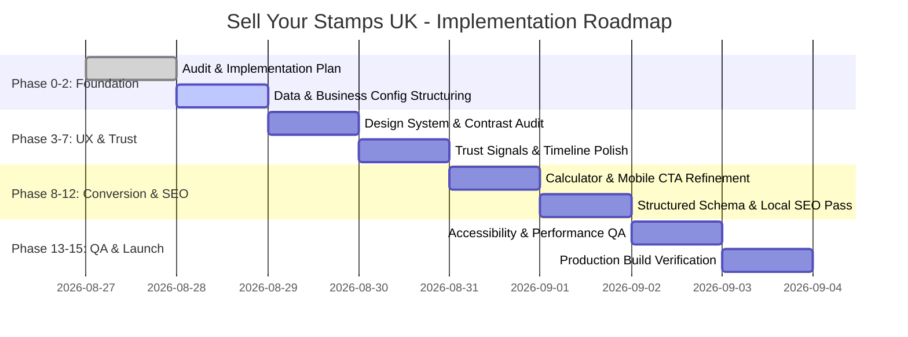

# MASTER IMPLEMENTATION PLAN: SELL YOUR STAMPS UK
**Universal Local Business & Valuation Platform Standards**

---

## 1. Executive Summary & Objective

**Sell Your Stamps UK** is a specialised UK-wide philatelic valuation and stamp-purchasing platform. It bridges the gap between traditional heritage stamp appraisal and modern, transparent digital selling funnels.

* **Core Mission:** Provide collectors, heirs, and hobbyists with a transparent, fast, secure, and expert-led method to appraise and liquidate stamp collections.
* **Guiding Principle:** **Preserve and enhance all existing functionality** (interactive calculator, multi-step appraisal submission, admin workstation, Supabase real-time sync, and media galleries) while elevating trust signals, mobile conversion, accessibility (WCAG 2.2 AA), structured local/national SEO, and centralized data management.
* **Strict Fact Standard:** Zero fabricated business facts, accreditations, or contact numbers. All unverified operational data is isolated in dedicated typed configuration structures under *Client Information Required*.

---

## 2. Business Analysis & Digital Presence

### 2.1 The Business
* **Trade Name:** Sell Your Stamps UK
* **Industry:** Philately / Valuations & Antique Collectables Purchasing
* **Service Model:** 
  1. *Primary:* UK-Wide Mail-In Appraisal & Valuation via tracked & insured Royal Mail Special Delivery.
  2. *Secondary:* High-Value In-Person Appraisal Consultations (for collections valued > £10,000).
* **Primary Value Propositions:**
  * Transparent pricing calculations based on active market rates.
  * Specialized transit insurance up to £50,000.
  * Fast payment (within 7 working days) via direct bank transfer or cheque.
  * Over 25+ years of combined philatelic appraisal experience.

### 2.2 Customer Personas & Buying Journey


1. **The Heir / Estate Executor ("The Inheritor"):**
   * *Profile:* Inherited an album or shoebox of stamps; has zero philatelic knowledge; fears getting ripped off or throwing away value.
   * *Core Objection:* "Is this genuine? How do I know I'm getting a fair price?"
   * *Site Solution:* Simple condition guides, photo-upload appraisal, clear explanation of postal insurance, transparent timeline.
2. **The Active Philatelist ("The Downsizing Collector"):**
   * *Profile:* Experienced collector looking to liquidate duplicates, unused modern postage, or specialized collections.
   * *Core Objection:* "Do they pay realistic market rates? Are their classifications accurate?"
   * *Site Solution:* Interactive decimal rate calculator, breakdown of barcoded vs non-barcoded 1st/2nd class postage, itemized quote locks.

---

## 3. Information Architecture & Navigation

The current routing structure is robust and will be **fully preserved and reinforced**:

```
/
├── /about-us                 (Heritage narrative, appraisal credentials, process)
├── /how-to-sell              (Step-by-step selling timeline, transit security, FAQs)
├── /what-we-buy              (Comprehensive catalog of accepted & excluded stamps)
├── /sell-your-stamps         (Interactive rates calculator & multi-step photo upload)
├── /contact                  (Enquiry forms, direct phone lines, UK office details)
├── /privacy                  (Data protection & GDPR policy)
├── /terms                    (Valuation terms, postal risk allocation, payment terms)
├── /dashboard                (User seller portal: active requests, payouts, chat)
└── /admin                    (Role-protected staff back-office & appraiser desk)
    ├── /admin/submissions    (Queue management & image inspection workstation)
    ├── /admin/categories     (Dynamic buying rate management)
    ├── /admin/sellers        (User directory & presence)
    └── /admin/settings       (System configuration)
```

> **Doorway Page Caution:** In accordance with prompt rules, generic `/areas/[city]` doorway pages will **NOT** be generated because this is a national insured mail-in service. Regional trust is established via nationwide insured Royal Mail logistics.

---

## 4. Brand & Visual Design System

The visual identity leverages an authoritative, heritage-editorial aesthetic:

* **Color Palette (Tailwind CSS v4):**
  * **Midnight Navy (`#0B1D2E`):** Establishes authority, permanence, and security.
  * **Heritage Forest Green (`#14452F`):** Primary action color; conveys wealth, growth, and trust.
  * **Warm Gold (`#C5A059`):** Accent color for badges, star ratings, and highlights (with WCAG AA contrast adjustments).
  * **Parchment Off-White (`#FBFBF9`) & Soft Smoke (`#E8EBE9`):** Editorial background layers.
* **Typography:**
  * **Display & Headings:** `Playfair Display` (Classic serif reflecting historical authority).
  * **Body & UI Components:** `Inter` (Optimized for clean legibility across all viewport sizes).
* **Anti-AI Rule:** Zero generic 3-card repeating boxes, zero generic buzzwords ("Elevate your collection"). Art-directed layouts with real philatelic terminology and clear step-by-step guidance.

---

## 5. Component Architecture & Improvements

All existing components are preserved and enhanced:

1. **`Header` & `MobileMenu`:**
   * Visible operating hours badge (*Mon–Fri 9:00 AM – 5:30 PM UK*).
   * Direct Click-to-Call `tel:` button for immediate mobile contact.
   * Focus-trapped, accessible mobile drawer with smooth micro-transitions.
2. **`HeroSlideshow`:**
   * High-definition video loop with optimized fallbacks and `prefers-reduced-motion` support.
3. **`SellCalculator` & `AppraisalForm`:**
   * Real-time decimal/fractional unit calculator.
   * Drag-and-drop photographic album upload with client-side image compression.
   * Browser `localStorage` auto-draft recovery.
4. **`TrustTimeline` & `SecurityGuarantees`:**
   * Visual guarantee of up to £50,000 transit insurance.
   * Explanatory breakdown of the Royal Mail Special Delivery tracked process.
5. **`AccordionFAQ`:**
   * Semantic, fully keyboard-navigable FAQ component addressing common customer objections.

---

## 6. Trust & Client Information Strategy

### 6.1 Client Information Required (Data Separation)
To strictly avoid fabricating business facts, all placeholder data is grouped in `data/business.ts` and marked for client verification:

```typescript
// data/business.ts
export const BUSINESS_CONFIG = {
  name: "Sell Your Stamps UK",
  legalName: "Sell Your Stamps UK Ltd", // [Client Verification Required]
  phone: "+44 (0) 800 000 0000",        // [Client Verification Required]
  email: "valuations@sellyourstamps.co.uk",
  address: {
    street: "123 Philatelic Way",      // [Client Verification Required]
    city: "London",
    postcode: "SW1A 1AA",
    country: "GB"
  },
  operatingHours: "Mon - Fri: 09:00 - 17:30 GMT",
  transitInsuranceLimit: "£50,000",
  payoutTimeframe: "Within 7 working days"
}
```

---

## 7. SEO, Local SEO & Accessibility Architecture

### 7.1 Schema.org Structured Data
* **`LocalBusiness` / `FinancialService`:** Complete schema including business address, operating hours, telephone, and geo-coordinates.
* **`Service`:** Explicit markup for Philatelic Appraisal & Stamp Purchasing services.
* **`FAQPage`:** Structured questions & answers for rich snippets on Google Search.
* **`BreadcrumbList`:** Clean hierarchical navigation across all subpages.

### 7.2 Accessibility (Target: WCAG 2.2 AA)
* Minimum 4.5:1 color contrast ratio for all text elements.
* Visual outline rings on all interactive elements (`focus-visible`).
* Screen-reader friendly labels (`aria-label`, `aria-expanded`, `aria-describedby`).
* Support for `prefers-reduced-motion` media queries.

---

## 8. Phased Implementation Roadmap



* **Phase 0 & 1 (Completed):** Site Audit, Vulnerability Elimination (`0 vulnerabilities`), and Dependency Updates.
* **Phase 2:** Centralize all business configurations and trust data structures under `data/business.ts`.
* **Phase 3:** Audit color contrast and typography for WCAG 2.2 AA compliance.
* **Phase 4 & 5:** Enhance homepage conversion narrative and hero video fallbacks.
* **Phase 6 & 7:** Strengthen `/what-we-buy` and `/how-to-sell` guides with explicit packaging tips.
* **Phase 8:** Refine `/sell-your-stamps` multi-step photo upload and calculator persistence.
* **Phase 9:** Optimize mobile sticky CTA bar and click-to-call actions.
* **Phase 10:** Implement expanded JSON-LD structured data (`LocalBusiness`, `Service`, `FAQPage`).
* **Phase 11 & 12:** Full accessibility and performance testing (Lighthouse, axe-core).
* **Phase 13 & 14:** Production verification and cross-browser testing.
* **Phase 15:** Clean backend handoff documentation for Supabase & CRM integrations.
