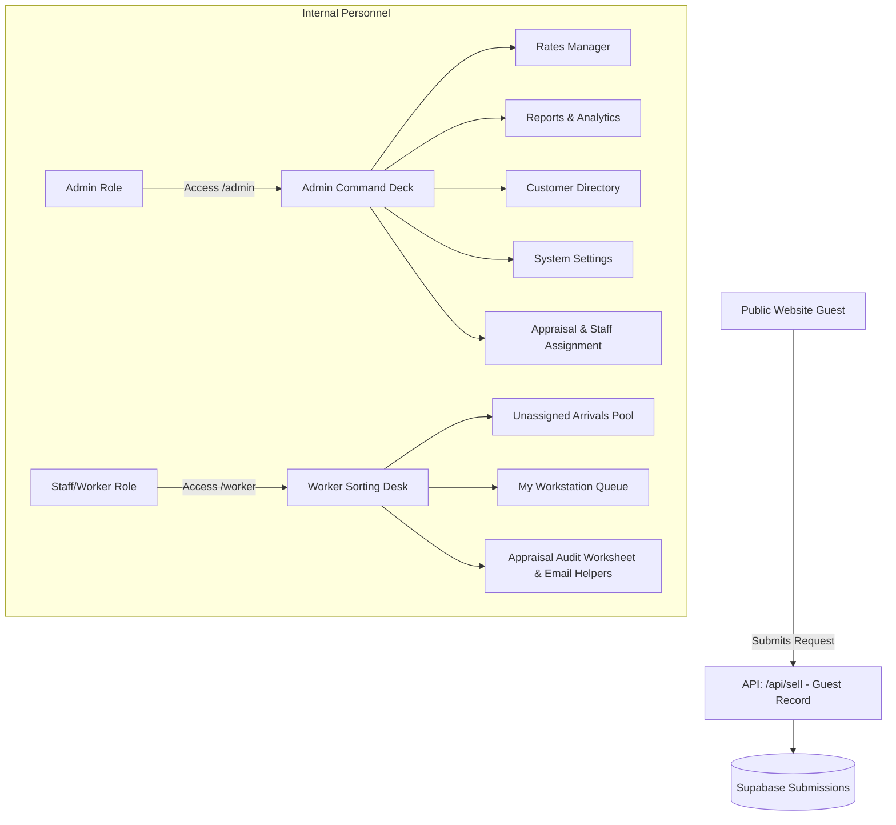

# Architectural Restructure Plan: Dual Dashboard (Admin & Worker) + Guest-Only Submissions

This document details the architectural restructure to transition the **UK Stamp Valuations** platform from a 3-tier system (Public Seller, Staff, Admin) to a streamlined **2-Tier Dual Dashboard architecture** (Admin & Worker) with 100% guest-only public submissions.

---

## Executive Summary & Key Decisions

1. **Public Seller Accounts & Dashboard Removed**:
   - Retire the `/dashboard` route, seller signup (`/signup`), seller profile settings, and seller payout method management.
   - Public users can view live rates, use the valuation calculator, and submit valuation requests **without creating an account**.
2. **Public Entry Point Audit & Cleanup**:
   - Remove public "Sign In" link from `components/layout/footer.tsx`.
   - Remove public seller portal references from `components/layout/header.tsx`.
   - Ensure **zero public entry points** exist anywhere on the main site pointing to `/login` or `/dashboard`.
3. **Auth System Repurposed for Internal Personnel Only**:
   - Login (`/login`) is restricted exclusively to internal users (`role = 'admin'` or `role = 'staff'`).
   - Magic link / password reset logic is retained solely for internal staff password recovery.
4. **Dedicated Worker Dashboard (`/worker`) Introduced**:
   - Staff/appraisers access a dedicated sorting desk workstation (`/worker`) containing:
     - My Active Workstation Queue (claimed parcels).
     - Unassigned Arrivals Pool (incoming guest requests).
     - Appraisal Audit Worksheet (photo zoom/rotate, quantity auditing, internal staff notes, 1-click email launchers & canned snippets).
5. **Admin Sidebar Streamlined**:
   - **Command Deck Header**: Retained.
   - **Rates Manager (`/admin/categories`)**: Retained (Admin only).
   - **Reports (`/admin/reports`)**: **RETAINED** (Admin only). Provides critical operational analytics on submission volume, category breakdown, payout trends, and appraisal turnaround times independent of seller accounts.
   - **Customer Submitter Directory (`/admin/sellers` or `/admin/customers`)**: Repurposed from seller profiles to an aggregated directory of past guest submitters (grouped by email).
   - **System Settings (`/admin/settings`)**: Retained.
   - **Removed Items**:
     - *Payout Bonuses (`/admin/bonuses`)*: **Retired**. Previously allowed creating seller promo codes (e.g., `SUMMER10`) for sellers to claim bonuses during portal submissions. Without seller accounts, promo codes are obsolete; staff can apply manual valuation adjustments directly on the appraisal worksheet.
     - *Marketing Outreach (`/admin/marketing`)*: Removed from sidebar navigation.

---

## Detailed Architectural Review

### 1. Phase 3 Guest-Linkage Impact
- **Status**: **Obsolete & Retired**.
- **Rationale**: Previously, Phase 3 included database triggers (`link_guest_submissions_to_profile`) that automatically linked guest submissions to a user profile when they registered later. Since public user registration is eliminated, all submissions remain guest records (`guest_name`, `guest_email`, `guest_phone`, `guest_postcode`). The auto-linking database trigger and profile linkage functions will be dropped from Supabase.

### 2. Phase 2 Auth System Repurposing
- **Status**: **Restricted to Internal Personnel**.
- **Rationale**:
  - Delete `/signup` page.
  - Restrict `/login` page: after authenticating, verify `profile.role` is either `admin` or `staff`. If a user with role `seller`/`user` attempts to log in, revoke session and display `"Access restricted to internal staff personnel."`
  - Middleware: Protect `/admin/*` and `/worker/*` routes with strict role checking.

### 3. Dual Dashboard Structure Definition

### 4. Seller Accounts Admin Page Restructuring
- **Status**: **Transformed into Customer Submitter Directory (`/admin/customers`)**.
- **Implementation**:
  - Replaces `SELECT * FROM profiles WHERE role = 'seller'` with a database view/query grouping `submissions` by `guest_email`.
  - Displays: Submitter Name, Email Address, Phone, Postcode, Total Submissions Count, Total Valuation Amount, Last Submission Date, and a link to filter all submissions by that email.

---

## Proposed File Changes

### [DELETE] Public Seller Dashboard Components & Pages
- Delete [app/dashboard](file:///c:/Users/Deepg/OneDrive/Desktop/The%20Real%20World/Campuses/AI%20Automation/New%20Lessons/CODING/v0-stamp-valuation-app/app/dashboard)
- Delete [app/(auth)/signup](file:///c:/Users/Deepg/OneDrive/Desktop/The%20Real%20World/Campuses/AI%20Automation/New%20Lessons/CODING/v0-stamp-valuation-app/app/(auth)/signup)
- Delete [components/dashboard](file:///c:/Users/Deepg/OneDrive/Desktop/The%20Real%20World/Campuses/AI%20Automation/New%20Lessons/CODING/v0-stamp-valuation-app/components/dashboard)

### [MODIFY] Public Site Header & Footer Cleanup
#### [MODIFY] [components/layout/footer.tsx](file:///c:/Users/Deepg/OneDrive/Desktop/The%20Real%20World/Campuses/AI%20Automation/New%20Lessons/CODING/v0-stamp-valuation-app/components/layout/footer.tsx)
- Remove `/login` link from bottom links list.

#### [MODIFY] [components/layout/header.tsx](file:///c:/Users/Deepg/OneDrive/Desktop/The%20Real%20World/Campuses/AI%20Automation/New%20Lessons/CODING/v0-stamp-valuation-app/components/layout/header.tsx)
- Update profile links to point exclusively to `/admin` or `/worker` for logged-in staff, omitting `/dashboard` entirely for public guests.

### [MODIFY] Admin Sidebar Navigation & Layout
#### [MODIFY] [components/admin/sidebar.tsx](file:///c:/Users/Deepg/OneDrive/Desktop/The%20Real%20World/Campuses/AI%20Automation/New%20Lessons/CODING/v0-stamp-valuation-app/components/admin/sidebar.tsx)
- Keep under "Command Deck":
  - Command Deck (`/admin`)
  - Submissions Queue (`/admin/submissions`)
  - Rates Manager (`/admin/categories`)
  - Reports & Analytics (`/admin/reports`)
  - Submitter Directory (`/admin/sellers` re-labeled to "Customer Directory")
  - Settings (`/admin/settings`)
- Remove Payout Bonuses and Marketing links.

### [NEW] Worker Dashboard (`/worker`)
#### [NEW] [app/worker/page.tsx](file:///c:/Users/Deepg/OneDrive/Desktop/The%20Real%20World/Campuses/AI%20Automation/New%20Lessons/CODING/v0-stamp-valuation-app/app/worker/page.tsx)
- Dedicated lightweight sorting desk interface for staff appraisers displaying assigned parcels and unassigned arrival pools.

---

## Verification Plan

### Automated Verification
- Run `npm run build` to verify clean compilation after removing public dashboard routes.
- Verify middleware correctly blocks unauthenticated or non-staff users from accessing `/admin` and `/worker`.

### Manual Verification
1. **Public Site Cleanliness**: Audit homepage, header, footer, and mobile nav to confirm zero links exist to `/login`, `/signup`, or `/dashboard`.
2. **Public Guest Submission**: Submit a guest valuation request on homepage and confirm it creates a submission record in Supabase without requiring account creation.
3. **Internal Auth Gate**: Attempt logging in with seller/invalid credentials and verify access is denied with a clear message. Log in with admin/staff credentials and verify redirection to `/admin` or `/worker`.
4. **Worker Workstation**: Verify staff can claim unassigned arrivals, audit quantities, add staff notes, and use email helpers cleanly.
