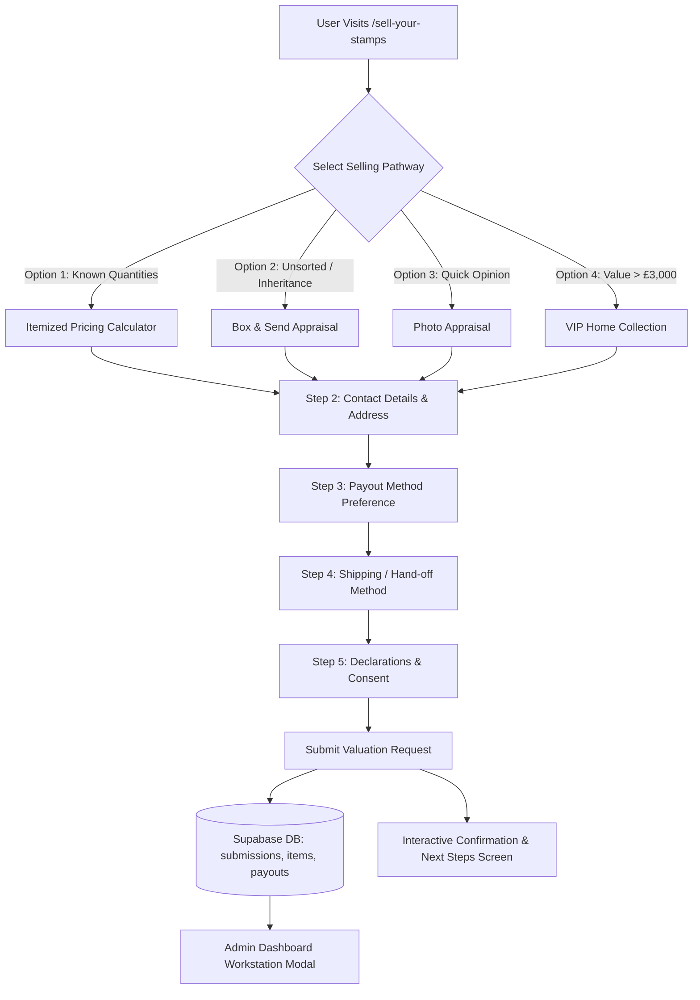

# IMPLEMENTATION PLAN: MULTI-OPTION STAMP SELLING WORKFLOW, SUPABASE PERSISTENCE & ADMIN WORKSTATION

---

## 1. Executive Summary & Objective

This document outlines the complete architectural, database, frontend, and admin workstation plan for enabling users to seamlessly appraise and sell stamps to **Sell Your Stamps UK**. 

Based on our competitor benchmark of **WeBuyAnyStamps.co.uk**, our system resolves their primary friction points (e.g., flat rejection of unsorted collections, forcing sellers to pay upfront postage, rigid tabular inputs) while maintaining bank-grade security, instant pricing transparency, and same-day payout capabilities.

### Key Goals:
1. **Multi-Pathway Selling Forms:** Provide flexible intake options for different seller types (Itemized Calculator, Box & Send, Photo Appraisal, and VIP Estate Collection).
2. **Comprehensive Data Capture:** Collect all required personal, item, payout, shipping, and consent data in a guided multi-step form.
3. **Reassuring Post-Submission Response:** Deliver an intuitive, branded confirmation page/modal informing the user that their stamps are under review, outlining clear next steps (call/SMS/email), and providing printable packing instructions.
4. **Supabase Persistence:** Persist all structured item breakdowns, payout credentials, shipping selections, and status flags cleanly in Supabase.
5. **Unified Admin Workstation (`/admin/submissions`):** Provide admins with an interactive modal/drawer displaying complete submission information, one-click payout copying, recount adjustments, and real-time toast feedback.
6. **100% Mobile Optimization:** Form factor optimized for handheld devices with native touch targets, numeric keypads, responsive tables, and zero horizontal scrolling.

---

## 2. Multi-Pathway Selling Architecture



### Selling Pathways Detail:
1. **Option 1: Itemized Instant Lock-In Calculator**
   * *Target:* Posties, businesses, Royal Mail survey recipients with complete sheets/booklets.
   * *Behavior:* Live JavaScript calculations against current buying rates. Rate locked in for 14 days.
2. **Option 2: "Box & Send" (We Sort & Value)**
   * *Target:* Inherited collections, mixed albums, boxes of envelopes where the seller cannot count or classify stamps.
   * *Behavior:* Captures box count, estimated weight, era range (decimal, pre-decimal, mixed), and overall photos. Staff counts and itemizes upon delivery.
3. **Option 3: Photo / Fast Valuation Request**
   * *Target:* Quick mobile uploads of 1–5 key items or older commemorative albums.
   * *Behavior:* Image-first submission with seller notes; appraiser reviews within 2 hours.
4. **Option 4: VIP Estate & Bulk In-Person Collection (> £3,000 Face Value)**
   * *Target:* High-value collections, deceased estates, philatelic dealer liquidations.
   * *Behavior:* Priority callback scheduling; option for white-glove collection or courier freight.

---

## 3. Data Collection Requirements (The Intake Funnel)

### Step 1: Stamp Details (Varies by Pathway)
* **Calculator:** Category IDs, quantities, face values, calculated subtotal.
* **Box & Send:** Container type (shoebox, album carton, crate), estimated era, approx weight (kg), notes.
* **Photo Appraisal:** High-resolution image uploads (camera direct on mobile), seller commentary.
* **VIP Collection:** High-level estimate, collection location, availability window.

### Step 2: Seller Information
* Full Legal Name (First & Last)
* Mobile Telephone Number (with UK validation `+44` / `07xxx`)
* Email Address (with RFC format validation)
* Postal Address Line 1 & 2
* Town / City & Postcode (UK format validated)

### Step 3: Payout Details & Verification
* **Preferred Payment Method:**
  * **Bank Transfer (BACS / Faster Payments):**
    * Account Holder Name
    * Bank Name
    * Sort Code (formatted `XX-XX-XX` with auto-hyphenation)
    * Account Number (8 digits, validated)
  * **PayPal:**
    * Verified PayPal Email Address
  * **Cash on Delivery / In-Person:**
    * Available for VIP in-person deals or hand delivery
  * **Cheque by Post:**
    * Payable name and delivery address confirmation

### Step 4: Shipping & Hand-Off Logistics
* **Prepaid Royal Mail QR Code Label:** Free over £150 or deducted (£4.95) from payout. No printer needed; scan QR at Post Office.
* **Self-Ship Special Delivery:** Customer sends directly using Royal Mail Special Delivery Guaranteed by 1pm with tracking reference input.
* **Home Courier Pickup:** For parcels exceeding 3kg or disabled/elderly sellers.

### Step 5: Seller Declarations & Legal Consent
* Checkbox 1: *"I confirm I am the legal owner of these stamps."*
* Checkbox 2: *"I understand all stamps will undergo 100% authenticity and UV check. Counterfeit or franked stamps cannot be purchased."*
* Checkbox 3: *"I accept that if the physical count differs from my submitted quantity, I will receive an updated itemized quote to approve before payment."*

---

## 4. Post-Submission Confirmation Experience

Upon clicking **"Submit Valuation & Sell Stamps"**, rather than a generic redirect, the user is greeted with an animated, high-trust **Response Screen / Confirmation Modal**:

```
┌─────────────────────────────────────────────────────────────────────────────────┐
│                           ✅ VALUATION SUBMITTED                                │
│                     Reference ID: #STAMP-84920-UK                               │
│                                                                                 │
│   "Thank you, John! Your stamp submission is now logged with our appraisal team."│
├─────────────────────────────────────────────────────────────────────────────────┤
│ ⏱️ WHAT HAPPENS NEXT?                                                           │
│                                                                                 │
│ 1. Initial Review (Within 2 Hours):                                             │
│    Our specialist appraisers are reviewing your details. You will receive an     │
│    SMS text message and confirmation email shortly.                             │
│                                                                                 │
│ 2. Inspection & Payout Target:                                                  │
│    Once your package arrives at our verification center, it enters physical     │
│    audit. We guarantee payment same-day by 2:00 PM upon count verification.    │
│                                                                                 │
│ 3. Direct Contact:                                                              │
│    If our team needs any clarification, an expert will call you directly at     │
│    07123 456789.                                                                │
├─────────────────────────────────────────────────────────────────────────────────┤
│ 📦 YOUR POSTAL INSTRUCTIONS                                                     │
│                                                                                 │
│ [ 📄 Download & Print Packing Slip ]       [ 📱 View Post Office QR Code ]      │
│                                                                                 │
│ Send your parcel to:                                                            │
│ UK Postage Stamps LTD                                                           │
│ Office 214, Regus, Bournemouth Oxford Point                                     │
│ 19 Oxford Road, Bournemouth, BH8 8GS                                            │
│                                                                                 │
│ 💡 No printer? Just write "#STAMP-84920-UK" clearly on paper inside the parcel. │
├─────────────────────────────────────────────────────────────────────────────────┤
│ Questions right now? Call our appraisals line on 07949 552094 or chat on WhatsApp│
└─────────────────────────────────────────────────────────────────────────────────┘
```

---

## 5. Supabase Database Schema

### 1. `submissions` Table
```sql
CREATE TYPE public.selling_pathway_type AS ENUM (
    'calculator', 
    'box_and_send', 
    'photo_appraisal', 
    'vip_collection'
);

CREATE TYPE public.shipping_preference_type AS ENUM (
    'prepaid_qr_label', 
    'self_ship_special_delivery', 
    'courier_pickup', 
    'home_visit'
);

-- Core enhancements on public.submissions
ALTER TABLE public.submissions 
ADD COLUMN IF NOT EXISTS selling_pathway public.selling_pathway_type NOT NULL DEFAULT 'calculator',
ADD COLUMN IF NOT EXISTS shipping_preference public.shipping_preference_type DEFAULT 'self_ship_special_delivery',
ADD COLUMN IF NOT EXISTS tracking_number TEXT,
ADD COLUMN IF NOT EXISTS prepaid_label_url TEXT,
ADD COLUMN IF NOT EXISTS parcel_weight_kg NUMERIC(6, 2),
ADD COLUMN IF NOT EXISTS original_quoted_value NUMERIC(12, 2) NOT NULL DEFAULT 0.00,
ADD COLUMN IF NOT EXISTS revised_offer_value NUMERIC(12, 2),
ADD COLUMN IF NOT EXISTS adjustment_reason TEXT,
ADD COLUMN IF NOT EXISTS seller_agreed_adjustment BOOLEAN DEFAULT NULL,
ADD COLUMN IF NOT EXISTS inspection_notes TEXT,
ADD COLUMN IF NOT EXISTS counterfeit_detected BOOLEAN DEFAULT FALSE,
ADD COLUMN IF NOT EXISTS unboxing_video_url TEXT;
```

### 2. `payouts` Table
```sql
CREATE TYPE public.payout_method_type AS ENUM (
    'bank_transfer', 
    'paypal', 
    'cash', 
    'cheque'
);

CREATE TYPE public.payout_status_type AS ENUM (
    'pending', 
    'authorized', 
    'paid', 
    'failed'
);

CREATE TABLE IF NOT EXISTS public.payouts (
    id UUID PRIMARY KEY DEFAULT gen_random_uuid(),
    submission_id UUID UNIQUE REFERENCES public.submissions(id) ON DELETE CASCADE NOT NULL,
    method public.payout_method_type NOT NULL,
    account_holder_name TEXT,
    bank_name TEXT,
    sort_code TEXT,
    account_number TEXT,
    paypal_email TEXT,
    payout_status public.payout_status_type DEFAULT 'pending' NOT NULL,
    paid_at TIMESTAMP WITH TIME ZONE,
    paid_by UUID REFERENCES public.profiles(id),
    transaction_reference TEXT,
    created_at TIMESTAMP WITH TIME ZONE DEFAULT CURRENT_TIMESTAMP NOT NULL
);
```

### 3. `submission_items` Table
```sql
CREATE TABLE IF NOT EXISTS public.submission_items (
    id UUID PRIMARY KEY DEFAULT gen_random_uuid(),
    submission_id UUID REFERENCES public.submissions(id) ON DELETE CASCADE NOT NULL,
    category_id TEXT REFERENCES public.stamp_categories(id) ON DELETE SET NULL,
    quantity NUMERIC(12, 2) NOT NULL,
    rate_at_submission NUMERIC(4, 3) NOT NULL,
    face_value_at_submission NUMERIC(10, 2) NOT NULL,
    calculated_value NUMERIC(12, 2) NOT NULL,
    reviewed_quantity NUMERIC(12, 2),
    reviewed_value NUMERIC(12, 2),
    notes TEXT
);
```

---

## 6. Admin Workstation (`/admin/submissions`)

### Queue Filtering
* **All Deals**
* **Instant Calculator** (Automated counts, awaiting parcels)
* **Box & Send / Unsorted** (Awaiting staff sorting & itemized quote)
* **Photo Valuations** (Pending initial quote review)
* **Arrived Today / Due 2PM** (Packages received this morning requiring verification and payment)
* **Completed & Paid**

### Detailed Submission Modal Components
1. **Seller Header & Identity:** Name, phone (with direct WhatsApp link), email, and postal address.
2. **Pathway Badge & SLA Timer:** Indicates whether it's an itemized calculation, box appraisal, or VIP visit, plus a live countdown to the 2:00 PM payout SLA.
3. **Logistics & Tracking:** Royal Mail tracking number with external link to Royal Mail Track & Trace, weight, and drop-off timestamp.
4. **Interactive Audit Recount Table:**
   * Shows user-submitted quantity vs. reviewed quantity.
   * Highlight flag `[!]` on discrepancies.
   * Auto-calculates revision difference.
5. **Security & Counterfeit Checklist:**
   * `[ ] UV phosphor band test passed`
   * `[ ] Barcode authenticity scan verified`
   * `[ ] Count matches declaration`
   * `[ ] No franked or glued stamps`
6. **Payment Credentials Drawer:**
   * BACS Sort Code & Account Number with dedicated `[Copy]` buttons.
   * PayPal email with one-click copy.
7. **Action Triggers with Toast Notifications:**
   * `Mark as Paid` -> Prompts for transaction reference -> Fires Toast: *"Payout of £141.84 marked as paid. Seller notified."*
   * `Send Adjustment Offer` -> Sends SMS/email with new total -> Fires Toast: *"Recount difference sent to seller for review."*
   * `Reject & Return Parcel` -> Fires Toast: *"Return shipment scheduled. Seller notified."*

---

## 7. Mobile UX & Accessibility Optimization Guidelines

1. **Touch Targets:** All inputs, tabs, and action buttons sized at minimum `48px x 48px` to ensure effortless mobile tapping.
2. **Native Keypads:**
   * `type="tel"` on phone inputs.
   * `inputMode="numeric"` and `pattern="[0-9]*"` on quantity, sort code, and bank account fields to trigger the numeric keypad on iOS/Android.
3. **Sticky Bottom Action Bar:** On mobile screens, the "Submit Valuation" / "Proceed to Next Step" button is pinned to the bottom of the viewport so users never lose context.
4. **Client-Side Image Compression:** Compress uploaded photos in the browser (Canvas API) before sending to Supabase Storage, preventing multi-megabyte upload timeouts on mobile 4G/5G connections.
5. **Zero Table Overflow:** On mobile viewports, the calculator table dynamically transforms into responsive cards with clear +/- increment buttons.
