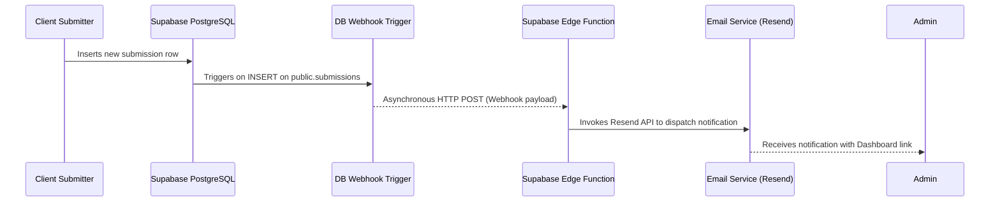

# Implementation Plan - Phase 3: Guest Valuation Linkage & Security

This document outlines the detailed implementation plan for updating the appraisal submission endpoint (`/api/sell/route.ts`) to handle both authenticated and guest submissions, configuring a secure email-verification-linked database trigger to link guest submissions, and setting up a robust audit trail.

---

## 1. 🚦 System Logic for Submission Endpoint (`/api/sell/route.ts`)

When a valuation is submitted through the Sell Form, the backend API (`/api/sell/route.ts`) must:
1. Identify if the request comes from an authenticated user (checking cookies/headers using the Supabase Server Client).
2. If **Authenticated**:
   * Link the submission by storing the user's UUID in the `user_id` column of the `submissions` table.
   * Save contact details. (Optional: default to profile details, or allow form overrides).
3. If **Guest** (unauthenticated):
   * Leave `user_id` as `NULL`.
   * Save contact fields: `guest_name`, `guest_email`, `guest_phone`, and `guest_postcode`.
4. Validate the requested stamp categories, calculate estimated valuation, and insert:
   * Main submission row into `submissions`.
   * Calculation snapshot details into `submission_items` (ensuring buying rates are locked at the time of submission).
   * Image details into `submission_images`.

### 🛡️ Server-Side Image & Path Security Validation
Before inserting records into the database:
* **Payload Format:** The client submits an array of images containing `file_path` and `image_url` (after uploading them directly to the `submissions` storage bucket).
* **Validation Rules:**
  1. **Quantity Limit:** Max 10 images per submission.
  2. **Existence & Size Verification:** Fetch metadata for each file using:
     ```typescript
     const { data: metadata, error } = await supabase.storage.from('submissions').getMetadata(filePath)
     ```
     Ensure the file exists, has a size <= 10MB (`10485760` bytes), and matches one of the allowed MIME types: `image/jpeg`, `image/png`, `image/webp`.
  3. **Path Prefix Security:** Validate that users can only submit images within their authorized storage directories:
     * **Authenticated Users:** The `file_path` must start with `${user.id}/`.
     * **Guest Users:** The `file_path` must start with `guest/`.
     * If there is a mismatch, reject the request with `400 Bad Request` to prevent path traversal or image hijacking.

---

## 2. ⚡ Secure Database Trigger for Automatic Linkage

To prevent account takeover and unauthorized data exposure (e.g., viewing guest submissions of a third-party email before confirming ownership), guest submissions will **only** be linked after a user verifies their email address.

### SQL Implementation
We will configure a Postgres trigger on the `auth.users` table. The trigger will check for `email_confirmed_at` updates:

```sql
CREATE OR REPLACE FUNCTION public.link_guest_submissions_on_verification()
RETURNS TRIGGER AS $$
BEGIN
    -- Only run linkage when email_confirmed_at transitions from NULL to a set timestamp
    IF NEW.email_confirmed_at IS NOT NULL AND (OLD.email_confirmed_at IS NULL OR OLD.email_confirmed_at IS DISTINCT FROM NEW.email_confirmed_at) THEN
        
        -- 1. Create audit trail entries in submission_history before updating user_id
        INSERT INTO public.submission_history (submission_id, changed_by, old_status, new_status, notes)
        SELECT id, NEW.id, status, status, 'Linked guest submission to user account upon email verification'
        FROM public.submissions
        WHERE (guest_email = NEW.email OR LOWER(guest_email) = LOWER(NEW.email))
          AND user_id IS NULL;

        -- 2. Update the user_id on all matching guest submissions
        UPDATE public.submissions
        SET user_id = NEW.id
        WHERE (guest_email = NEW.email OR LOWER(guest_email) = LOWER(NEW.email))
          AND user_id IS NULL;
          
    END IF;
    RETURN NEW;
END;
$$ LANGUAGE plpgsql SECURITY DEFINER;

-- Drop existing trigger if any
DROP TRIGGER IF EXISTS on_auth_user_verified_link ON auth.users;

-- Bind the trigger to auth.users updates
CREATE TRIGGER on_auth_user_verified_link
    AFTER UPDATE ON auth.users
    FOR EACH ROW
    EXECUTE FUNCTION public.link_guest_submissions_on_verification();
```

---

## 3. 📢 Admin Notifications (Deferred Architecture)

To ensure admin visibility into submissions, the future notification integration will use the following decoupled architecture:



### Future Implementation Strategy:
1. **Database Webhook:** Configured via Supabase Dashboard or CLI migration to watch `INSERT` events on the `submissions` table and send an HTTP POST to the Edge Function.
2. **Edge Function (`send-admin-notification`):**
   * Decodes the payload containing details like Submission ID, Submitter Name, Email, Era, and Estimated Valuation.
   * Utilizes the **Resend API** to email the admin at `gslegacywealth@gmail.com` with a call-to-action button linking directly to the admin appraisal directory.

---

## 4. 🛠️ Detailed Checklist & Implementation Steps

- [x] **Step 1: Write/Update Database Migrations**
  - [x] Add the `link_guest_submissions_on_verification` trigger function and trigger definition on `auth.users`.
  - [x] Confirm the database contains the correct status insertion trigger (`on_submission_inserted` executing `handle_submission_inserted()`).
- [x] **Step 2: Update `/api/sell/route.ts` API Endpoint**
  - [x] Initialize Supabase Server Client.
  - [x] Add payload validation: verify presence and format of required properties (`fullName`, `email`, `phone`, `postcode`, `collectionType`, `quantity`, `era`, `description`, `images`).
  - [x] Validate image array size (maximum 10 images).
  - [x] Implement storage metadata and path prefix security checks for each file in `images`.
  - [x] Implement transactional database insert:
    - [x] Create submission row (assigning `user_id` if authenticated, else keeping it null).
    - [x] Insert items into `submission_items` with current rates snapshotted.
    - [x] Insert image URLs into `submission_images`.
- [x] **Step 3: Verification & Manual Testing**
  - [x] **Test 1: Server-Side File Limits & Path Security**
    - [x] Test submitting with > 10 images. Verify endpoint returns `400 Bad Request`.
    - [x] Test submitting with an image path pointing to a different folder prefix (e.g. guest trying to use an auth path or user trying to use someone else's UID). Verify endpoint returns `400 Bad Request`.
    - [x] Test submitting with nonexistent storage file paths. Verify endpoint returns `400 Bad Request`.
  - [x] **Test 2: Authenticated Submission**
    - [x] Log in with a test user -> Submit appraisal.
    - [x] Check DB: Verify `submissions.user_id` is populated, user role in `profiles` changes to `'seller'`, and initial `submission_history` record is added.
  - [x] **Test 3: Guest Submission**
    - [x] Log out -> Submit appraisal using a guest email address.
    - [x] Check DB: Verify `submissions.user_id` is `NULL`, guest fields are populated, and initial `submission_history` record is added.
  - [x] **Test 4: Unverified Guest Linkage**
    - [x] Sign up a new user using the guest email. Keep the account **unverified** (do not click verification link).
    - [x] Check DB: Verify the guest submission has **not** been linked yet (`user_id` is still `NULL`).
  - [x] **Test 5: Verified Guest Linkage**
    - [x] Verify the user account (e.g., click verification link or manually set `email_confirmed_at` in database).
    - [x] Check DB: Verify the guest submission's `user_id` is now updated with the user's UUID.
    - [x] Verify `submission_history` table contains a new entry logging the linkage event with the new user's ID.
